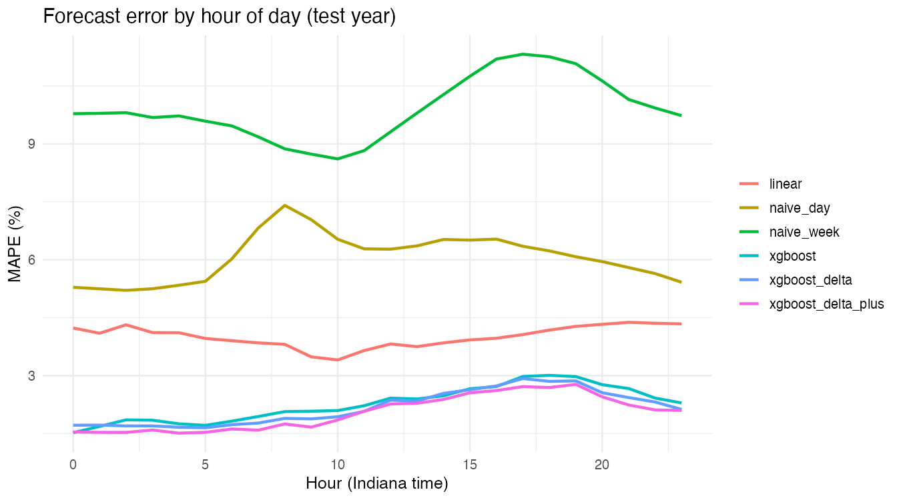
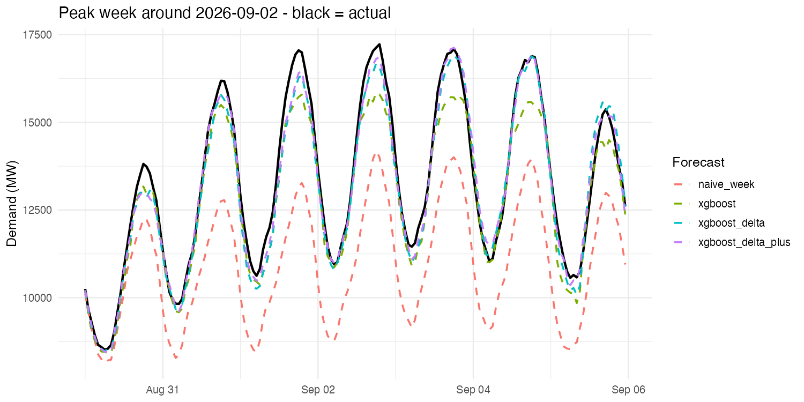

# Indiana Electricity Demand Forecaster

Day-ahead forecast of hourly electricity demand for Indiana (MISO Local Resource
Zone 6), built in R with the tidyverse and XGBoost.

Every midnight a grid operator has to predict how much power will be needed in
each hour of the next day: too little and it buys expensive emergency power,
too much and it wastes fuel. This project builds that forecast from public data:
hourly demand from the U.S. Energy Information Administration (EIA) and hourly
weather from Open-Meteo.

## Results (test year: _fill in dates_)

| Model | MAE (MW) | MAPE |
|---|---|---|
| Same hour last week (naive) | | |
| Same hour yesterday (naive) | | |
| Linear regression | | |
| **XGBoost** | | |

_Copy the numbers from `results/metrics.csv` after running the pipeline._




## Data

- **Demand:** EIA-930 hourly demand by subregion, MISO zone `0006` (LRZ 6), 2019 to present.
- **Weather:** Open-Meteo historical archive. Temperature, dew point, wind and
  cloud cover for six Indiana cities in MISO territory, population-weighted.

Zone 6 also includes a small part of western Kentucky, which EIA doesn't
report separately. See `lab_notes/notes.md`.

## Method

1. **Clean:** fill in missing hours, flag zero or spike values, interpolate gaps of 3 hours or less.
2. **Features:** hour, day of week, holidays, heating and cooling degrees, 24-hour
   rolling temperature, demand at the same hour 1, 2 and 7 days earlier, and
   the previous day's mean, max and last hour.
   Only information available at midnight before the forecast day is used.
3. **Split by time:** train (2019 to two years ago), validation (the year after
   that, used to choose the number of trees), test (most recent year).
4. **Models:** two naive baselines, a linear regression, and XGBoost.

**Caveat:** the models use actual weather as a stand-in for the weather
forecast, so real-world error would be somewhat higher.

## Project structure

```
indiana-energy-forecaster/
├── data/
│   ├── raw/            demand and weather as downloaded
│   └── processed/      model_table.csv (cleaned + features)
├── scripts/            run everything from here
│   ├── utils.R         shared paths, settings, metrics, feature list
│   ├── 00_setup.R      install packages, check API key
│   ├── 01_pull_demand.R
│   ├── 02_pull_weather.R
│   ├── 03_build_features.R
│   ├── 04_baselines.R
│   ├── 05_train_xgboost.R
│   ├── 06_evaluate.R
│   └── run_all.sh      runs 01 to 06 in order
├── results/            predictions, metrics, figures, saved model
└── lab_notes/          decisions and experiment log
```

## How to run

Requires R (4.1 or newer) and a free EIA API key (https://www.eia.gov/opendata/register.php).

```bash
export EIA_API_KEY="your_key"     # or put this line in ~/.bashrc
cd scripts
Rscript 00_setup.R                # once
bash run_all.sh                   # or run 01 ... 06 one at a time
```
